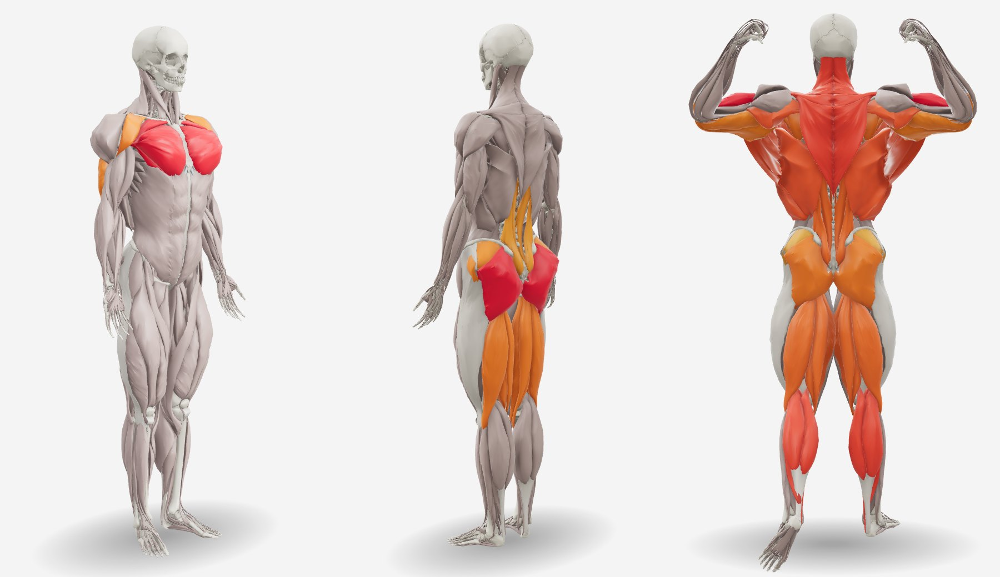

# body3d

A 3D muscle-activation viewer for the web. It draws an anatomical body — 135 muscles per side
over a full skeleton, built from [BodyParts3D](https://dbarchive.biosciencedbc.jp/en/bodyparts3d/) —
colours the muscles by activation, and shapes the body to a fat-free-mass index or to a person's
tape measures. It runs on three.js, needs no decoder or WebAssembly, and embeds as a library, a
custom element or an iframe.



- **Anatomy you can name.** 547 parts (muscles, tendons and fasciae, bones, cartilage), 44
  activatable groups and a 25-group gym vocabulary, in English and Brazilian Portuguese. Names
  match without case or accents: `"Chest"`, `"Peitoral"`, `"delt-front"`, `"Rectus femoris"`.
- **A body that changes.** Male and female models drawable from a lean to a very muscular body
  (normalized FFMI 15–32 and 12–26) through 14 regional morph targets, exact by construction.
- **Fitted to tape measures.** Each region follows the person's girths while total muscle stays
  that of their FFMI; calibrated on 6 068 measured adults (ANSUR II) and validated out of sample
  against statistical baselines — about 10 ms per fit.
- **Rigged and posed.** 52 joints placed from bone geometry, dual-quaternion skinning, six
  classic bodybuilding poses per sex.
- **Shows the right side.** An automatic default view per set of activations (triceps from
  behind, chest at 3/4, biceps from the front) and a split view with the opposite side.
- **Built for products.** GPU picking with tooltips, accessible description of what is active,
  reduced motion, theming through CSS variables, two resolutions (380 k / 159 k triangles, 5.7 /
  2.6 MB gzipped), a strict Content-Security-Policy is enough.
- **Reproducible.** A Python pipeline turns BodyParts3D into the models; builds are byte-identical.

## Quick start

```bash
# not on npm yet: install a release tag from GitHub (see "Install from a release" below)
npm install https://github.com/leosalim/body3d/archive/refs/tags/v0.3.0.tar.gz three
```

```js
import { createBodyViewer } from 'body3d'

const viewer = createBodyViewer(document.querySelector('#body'), {
  model: 'female',               // or 'male'
  view: 'auto',                  // the best view for the activations
  modelBaseUrl: '/models/'       // where male.glb, female.glb, *-lite.glb are served
})
viewer.setActivations([
  { muscle: 'Glutes', activation: 100 },
  { muscle: 'Hamstrings', activation: 60 },
  { muscle: 'rectus-femoris', activation: 40, side: 'left' }
])
viewer.addEventListener('select', (e) => console.log(e.detail?.label))   // tap a muscle
viewer.setFfmi(19)                                                         // leaner body
```

Give the container a size; the viewer fills it. The four model files are in `public/models/`
(or `body3d/models/*` in the package): serve them as `model/gltf-binary` with gzip.

| How | When |
|---|---|
| `import … from 'body3d'` | an application with a bundler; `three` is a peer dependency, shared with the app |
| `import … from 'body3d/standalone'` | a plain page; three.js is inside (218 kB gzipped) |
| `<body3d-viewer>` (`defineBodyElement()`) | frameworks without a wrapper component |
| `embed.html` in an `<iframe>` | another origin, configured by URL and `postMessage` |
| `body3d/vite` plugin | Vite apps bundling from source: alias `@body3d`, models served and copied |

Everything is in [docs/api.md](docs/api.md).

## Documentation

| Document | What it covers |
|---|---|
| [docs/api.md](docs/api.md) | options, methods, events, activation names, views, the fit input and result, element and iframe |
| [docs/architecture.md](docs/architecture.md) | how the runtime is organised: modules, rendering, picking, skinning, transitions |
| [docs/model-format.md](docs/model-format.md) | the GLB contract between the pipeline and the viewer |
| [docs/pipeline.md](docs/pipeline.md) | building the models from BodyParts3D, stage by stage, and its traps |
| [docs/anatomy.md](docs/anatomy.md) | what was selected, cut out and synthesized; hypertrophy, female proportions, rig, poses |
| [docs/body-fit.md](docs/body-fit.md) | fitting the body to tape measures: method, calibration on ANSUR II, validation |
| [docs/views.md](docs/views.md) | saved views, the automatic best view and its evaluation, the split view |
| [docs/decisions.md](docs/decisions.md) | every design decision with the alternatives studied and the evidence |
| [docs/catalog.md](docs/catalog.md) | generated: BodyParts3D concepts used, groups, training vocabulary, regions |
| [docs/validation/ansur-holdout.md](docs/validation/ansur-holdout.md) | the out-of-sample validation of the fit against statistical baselines, in full |
| [docs/validation/anatomy-checks.md](docs/validation/anatomy-checks.md) | the geometry checked: additive morphs, isotropic limbs vs stacking, muscle volumes vs MRI |
| [docs/validation/studies.md](docs/validation/studies.md) | the studies that need people — protocols and scripts, not yet run |
| [docs/references.md](docs/references.md) | literature and data sources |
| [paper/](paper/) | a technical paper describing the system (LaTeX) |

## Repository layout

```
body3d/
├── src/              the library (plain ES modules) + demo and embed pages
├── public/models/    male.glb, female.glb, male-lite.glb, female-lite.glb (built by the pipeline)
├── pipeline/         Python: BodyParts3D → GLB (selection, synthesis, rig, morphs, fit data)
├── catalog/          bp3d-elements.json — the 2 234 BodyParts3D meshes, classified
├── dev/              tools: calibration and validation on ANSUR II, study kits, visual snapshots, figures, view batch
├── test/             node:test suites (fit, activations, views, model contract, exports)
├── docs/             documentation and figures
├── paper/            the LaTeX paper
├── index.html        demo app
└── embed.html        page for an <iframe>
```

## Development

```bash
npm install
npm run dev          # demo at http://localhost:5190, embed at /embed.html
npm run check        # lint + type declarations + tests
npm run build        # dist/app (demo), dist/lib/body3d.js, dist/lib/body3d.standalone.js
node dev/snapshots.mjs /tmp/before                      # visual regression: render the scenarios…
node dev/snapshots.mjs /tmp/after --compare /tmp/before # …and diff them after a change
```

Rebuilding the models needs Python 3.11+ and ~200 MB of BodyParts3D downloads; then a
re-calibration with the public ANSUR II file. See [docs/pipeline.md](docs/pipeline.md) and
[CONTRIBUTING.md](CONTRIBUTING.md).

### Install from a release

The package is not on npm yet. A release tag installs from GitHub, as source: the archive has
`src/`, the models and the Vite plugin, but no `dist/` (bundles are built, not committed). So:

- **Vite** — use the plugin; it aliases `@body3d` to the source and serves and copies the models:

  ```js
  // vite.config.js
  import { body3d } from 'body3d/vite'
  export default defineConfig({ plugins: [body3d()] })

  // in the application
  import { createBodyViewer } from '@body3d'
  ```

- **Another bundler** — point it at `node_modules/body3d/src/index.js` and serve
  `node_modules/body3d/public/models/` yourself.
- **A plain page** — clone, `npm install && npm run build`, and take `dist/lib/body3d.standalone.js`.

Once published, `import … from 'body3d'` works as in the quick start.

## Licences and attribution

- **Code** (everything except `public/models/` and data derived from third parties): MIT, see
  [LICENSE](LICENSE).
- **Models** (`public/models/*.glb`) and the anatomical catalog are derived from
  **BodyParts3D, © The Database Center for Life Science, licensed under CC Attribution 4.0
  International**, and are distributed under the same licence. Attribution is required wherever
  the models are shown: the viewer displays it by default (`credit: false` only when the
  application credits BodyParts3D elsewhere). See [NOTICE.md](NOTICE.md).
- **Calibration** (`src/calibration.generated.js`) holds statistics computed from ANSUR II, a
  public dataset of the U.S. Army; the raw data is not redistributed.

body3d was first written for Trace, a strength-training tracker, whose muscle-group vocabulary
became the built-in training groups. If you use it in research, cite it with
[CITATION.cff](CITATION.cff). Security problems: see [SECURITY.md](SECURITY.md).
