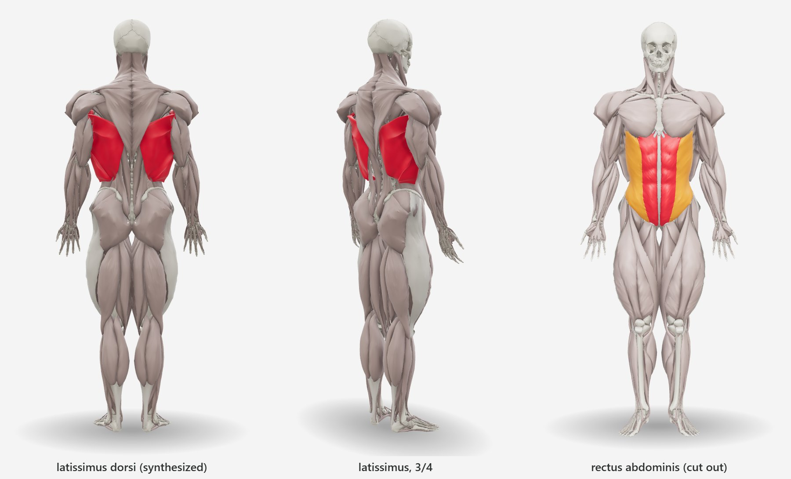
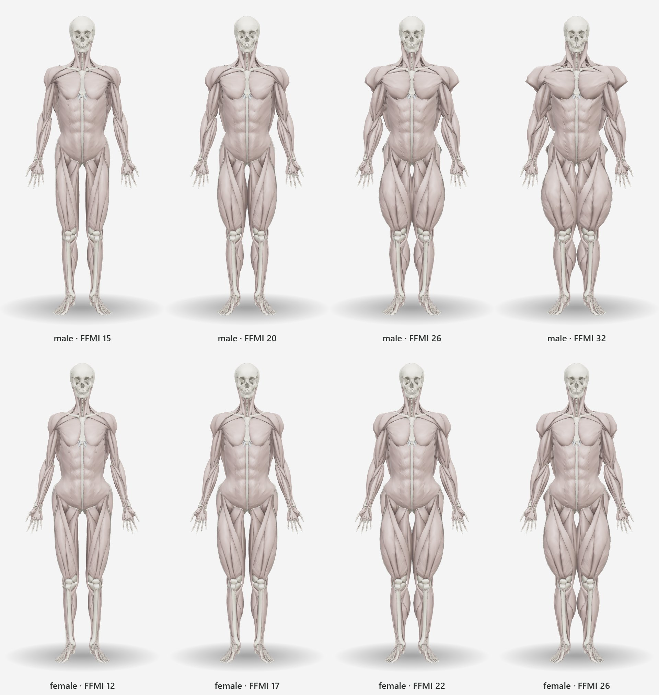
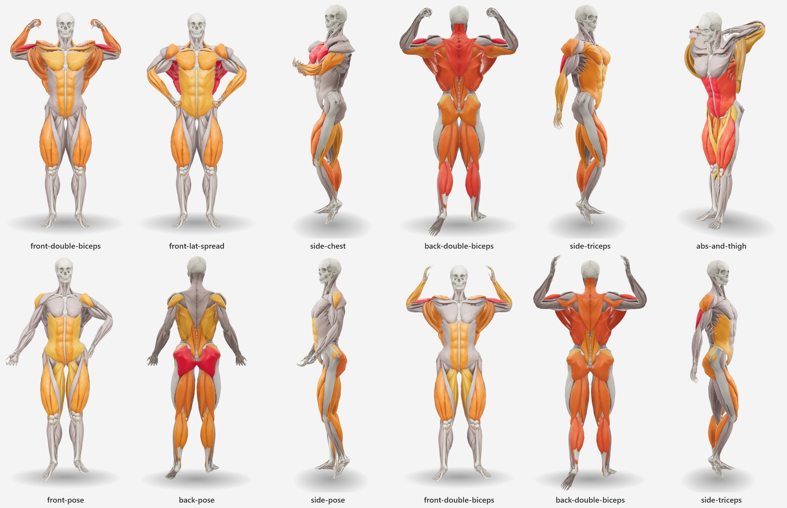

# Anatomy and method

How the body was built from BodyParts3D, why each choice was made, and where to change it. The
numbers measured on the models are printed by `pipeline/build.py` on every build. The table of
what is used is generated in [catalog.md](catalog.md); the alternatives weighed for each decision
are in [decisions.md](decisions.md).

- [1. The source: BodyParts3D 4.0](#1-the-source-bodyparts3d-40)
- [2. Selection and groups](#2-selection-and-groups)
- [3. Cut out and synthesized](#3-cut-out-and-synthesized)
- [4. Geometry processing](#4-geometry-processing)
- [5. From FFMI to muscle volume](#5-from-ffmi-to-muscle-volume)
- [6. Hypertrophy in layers](#6-hypertrophy-in-layers)
- [7. Female proportions](#7-female-proportions)
- [8. Rig and skinning](#8-rig-and-skinning)
- [9. Poses](#9-poses)
- [10. Ambient occlusion](#10-ambient-occlusion)
- [11. Known limits](#11-known-limits)

## 1. The source: BodyParts3D 4.0

BodyParts3D (Mitsuhashi et al. 2009) is a database of the Database Center for Life Science (DBCLS,
Japan, 2008–2013) in which every anatomical concept of the Foundational Model of Anatomy (FMA;
Rosse & Mejino 2003) that has a shape is a polygon mesh of **one adult male body**. Only atomic
"element" concepts have meshes (`FJxxxx.obj`, millimetres); composite organs are lists of
elements. Symmetric pairs are mirrors (the left file carries an `M` suffix). Coordinates: x
towards the body's left, y backwards, z up — converted to metres and three.js axes (x left,
y up, z forward).

Of its 2 234 meshes, 426 are muscles, 225 bones and 30 cartilage; the rest are vessels, nerves,
viscera and skin ([catalog.md](catalog.md) §1). The body is 1.707 m tall with 18.7 L of
represented muscle: a lean man, **FFMI ≈ 15** by the computation of §5.

Since 2025 the data is under **CC BY 4.0** (the OBJ headers still mention the older CC BY-SA 2.1
JP): commercial use is allowed with attribution, which the viewer shows by default.

What BodyParts3D 4.0 **lacks** and matters for training:

| Structure | Why it matters | Solution |
|---|---|---|
| Latissimus dorsi | "lats": pull-ups, rows, pulldowns | synthesized (§3) |
| Rectus abdominis as its own mesh | "abs" | cut out of the abdominal wall (§3) |
| Patellar ligament | without it the patella floats above the tibia | synthesized (§3) |
| Internal oblique, transversus, quadratus lumborum, multifidus | deep, covered | left out; counted in the muscle mass through a coverage factor (§5) |
| Muscles of the face and of mastication | outside the context | the head stays a skull |

## 2. Selection and groups

Nothing enters the model because a classifier guessed it: `pipeline/anatomy.py` lists every
muscle by its FMA concept name (right side; the left is the same name with "left"), every tissue,
the bone-to-segment rules and the viscera used as the hypertrophy core. `anatomy.check()` fails
the build if a name is missing, a muscle has no left side, or the groups do not close.

**135 muscles per side** (133 from BodyParts3D + 2 synthesized), each in exactly one of **44
activatable groups**, labelled in English and Brazilian Portuguese (Terminologia Anatomica; SBA's
Terminologia Anatômica). A muscle may join several meshes (its heads: pronator teres, adductor
pollicis, the four lumbricals of the foot).

On top of the groups, **25 training groups** — the vocabulary of an exercise catalog ("Chest",
"Lats", "Upper Back"…) — map to groups or muscles with weights, because a training group usually
spans more than one structure. Choices that are not obvious:

- **Pectoralis in three parts** (clavicular, sternocostal, abdominal) — BodyParts3D's division and
  how training talks (incline vs decline press). "Chest" lights the three; "Upper Chest" and "Lower
  Chest" one each.
- **Deltoid in three parts** (clavicular = anterior, acromial = lateral, spinal = posterior),
  matching the three deltoid groups of training.
- **Trapezius in three parts** (descending, transverse, ascending). "Upper Back" = rhomboids +
  middle trapezius + lower trapezius (0.8) + teres major (0.6).
- **Teres major** has its own group and joins "Lats" with the latissimus (both extend and adduct
  the shoulder in pulls).
- **Brachioradialis** has its own group: an elbow flexor (hammer curl) living in the forearm. It
  enters "Forearms" (1) and "Brachialis" (0.5).
- **Gluteus medius and minimus** form "Abductors" with the tensor fasciae latae; "Glutes" lights
  the maximus (1) and the medius/minimus (0.5).
- **Hip Flexors** = iliopsoas (1) + rectus femoris, sartorius and TFL (0.5–0.6), which cross the
  hip in front.
- **Calves** = gastrocnemius (with plantaris) + soleus, in separate groups, so a standing calf
  raise (knee straight, gastrocnemius) can be told from a seated one (soleus).
- Tibialis and extensors, fibularis, deep calf flexors, hand, foot, intercostals, deep hip
  rotators and scalenes/hyoids have no training group but can be activated by id.

Visible tissues, never activated, drawn in tendon colour: linea alba, iliotibial tracts, calcaneal
tendons and patellar ligaments. Left out (deep, visceral or covered): muscles of the eye, ear,
pharynx, larynx, tongue, heart, pelvic floor, diaphragm, internal and innermost intercostals,
suboccipitals, rotatores/interspinales/intertransversarii, platysma and the posterior serrati
(which would only show because the latissimus aponeurosis is not drawn — §3).

## 3. Cut out and synthesized

### Rectus abdominis

In BodyParts3D the "right external oblique" mesh (`FJ1452`) is the whole anterior wall: the rectus
and its tendinous intersections are on it. The lateral border of the rectus (the linea
semilunaris) shows as a groove; measured on horizontal slices it lies ~5 cm from the midline near
the pubis, 6.3–7 cm between the navel and the costal arch, and opens to ~9 cm at the costal
margin. `split.py` cuts exactly along that profile (an iso-line of a scalar field: new vertices on
the line, duplicated for each side), so both parts stay glued and each lights on its own.

### Latissimus dorsi

Anatomy (Gray's Anatomy, 41st ed.): origin on the spinous processes of T7–T12, through the
thoracolumbar fascia on the lumbar vertebrae and sacrum, the posterior third of the iliac crest and
the last ribs; insertion on the floor of the intertubercular sulcus of the humerus. Superficial to
the erector spinae, serratus posterior inferior, lower ribs and teres major, which it wraps from
below to form the posterior axillary fold. The ascending trapezius covers its superomedial corner.

Construction (`synth.py`):

1. **Support**: a signed distance field (2.5 mm voxels) of the ribs, spine, scapula, pelvis,
   erectors, serrati, external oblique, teres major and viscera. A morphological closing covers
   the gaps between ribs; filling every horizontal slice keeps a fibre from cutting through the
   thorax. The arm stays out of the support, or the lateral fibres would wrap the humerus instead
   of entering the axilla.
2. **Fleshy origin**: close to the spine under the trapezius (T7–T11), along the lateral border of
   the erectors over the lower back (~6.5 cm from the midline on the model), then along the iliac
   crest. The medial aponeurosis is not drawn: it is thin and, drawn, would hide the erectors —
   the "Lower Back" group.
3. **Fibres**: 36 elastic bands from the origin to the sulcus, relaxed over the support in
   multiresolution (9 → 17 → 33 → 65 → 96 points; a band of n points needs ~n² iterations to
   become taut). Each iteration shortens the band (neighbour average) and pushes points that went
   inside the support back out along the distance gradient. The last 16 % stays free to enter the
   axilla.
4. **Solid**: the sheet of fibres gets a thickness by volume conservation — ∝ width at the origin ÷
   local width, capped at 2 cm — thinned at the free borders and flattened into a tendon at the
   insertion; its growth under hypertrophy fades along the tendon.
5. **Finishing**: the latissimus is pushed out of the deep muscles where it touches, smoothed,
   pushed again, and the ascending trapezius is pushed out of the latissimus.

### Patellar ligament

A flat band (~3 cm × 6 mm) from the apex of the patella to the tibial tuberosity, held off the bone
by the infrapatellar fat pad (a 6 mm forward bulge).

## 4. Geometry processing

- **Welding** coincident vertices and dropping degenerate and duplicate faces on load.
- **Decimation** (quadric error, `fast-simplification`) to a triangle budget per kind and LOD,
  distributed by surface area so the density is uniform across the body; a minimum per part keeps
  small muscles recognisable. Viscera are decimated hard: they are never drawn.
- **Taubin smoothing** (λ = 0.5, μ = −0.53) removes BodyParts3D's faceting and the decimation noise
  without shrinking; borders stay fixed so pieces cut from one mesh stay glued, and because it is
  linear it commutes with the morph targets (§6).
- **Voxelization** for anything volumetric (support of the latissimus, hypertrophy core, AO): ray
  parity along the three axes with a majority vote, which survives non-watertight meshes (the left
  femur does not close on the grid).

## 5. From FFMI to muscle volume

The body size parameter is the **fat-free mass index**, FFM / height² (kg/m²), normalized by
height as in Kouri et al. (1995): FFMI + 6.1 × (1.8 − height). Kouri et al. found ~25 as the
practical ceiling of drug-free men; the default bodies are very muscular: **26 male, 22 female**.

From fat-free mass (FFM) to skeletal muscle mass (SMM): Janssen et al. (2000), whole-body MRI in
468 adults, measured SMM ≈ 38 % of body mass in men and ≈ 31 % in women; with the body fat of those
samples, SMM/FFM ≈ 0.49 and ≈ 0.47 (our estimate). The ratio is higher in trained people: MRI
comparisons report 0.477 against 0.447 in college athletes and non-athletes (Midorikawa et al.
2007) and, in very large athletes, a skeletal-muscle index 56 % above controls for a fat-free-mass
index 44 % above (Abe et al. 2018) — a ratio about 8 % higher. The pipeline interpolates SMM/FFM
from 0.49 at FFMI 17 to 0.56 at FFMI 26 (male, +14 %) and from 0.47 at 14 to 0.52 at 22 (female,
+11 %): the direction is documented, **the slope is our assumption**, about twice the reported
differences.

Its reach is limited. It sets the table FFMI → uniform weight, which the uncalibrated body and,
with the ANSUR II calibration, the trunk of the typical body follow; the limbs and the fit's
volume target come from the calibration ([body-fit.md](body-fit.md)). With half the slope, the
default male (FFMI 26) would have 2 % less muscle and shoulders 2.7 cm narrower (139.1 → 136.4 cm);
the default female, shoulders 0.8 cm narrower.

The base model's SMM comes from its meshes: 18.7 L × 1.06 kg/L ÷ 0.92 (coverage: the model lacks
~8 % of the musculature, §1) = 21.5 kg, FFMI ≈ 15.1 at its 1.707 m. Scaled to the model heights
(volume ∝ height³), at the defaults:

| | Height | Normalized FFMI | FFM | SMM/FFM | SMM | Represented muscle |
|---|---|---|---|---|---|---|
| BodyParts3D | 1.707 m | ≈ 15.1 (raw) | ≈ 44 kg | 0.49 | 21.5 kg | 18.7 L |
| Male | 1.78 m | 26 | 82.0 kg | 0.56 | ≈ 45.8 kg | ≈ 39.6 L |
| Female | 1.65 m | 22 | 57.4 kg | 0.51 | ≈ 29.5 kg | ≈ 25.6 L |

The pipeline evaluates the normalized FFMI over a grid of hypertrophy gains (−0.4 … 3.0) and keeps
the gains of the range ends: **15–32** (male) and **12–26** (female; the female lite model reaches
12.2). The shape at the minimum plus the region morphs up to the maximum are exported with the
table FFMI → uniform weight.

## 6. Hypertrophy in layers

Inflating each muscle on its own along its normals makes the layers cross: the pectoralis enters
the deltoid, the biceps the brachialis. Instead (`morph.py`), every point moves by **the sum of the
thickening of all the muscle between it and the core** (bones, cartilage and viscera), measured
along the direction away from the core — the gradient of a smoothed distance field on 3 mm voxels:

    displacement(p) = g · ∫ emphasis(muscle under the path) · ds · direction(p)

- The inner face of a muscle rises with the outer face of the muscle below; the muscle itself
  thickens by its emphasis. Gaps between muscles (fascia, fat) do not grow.
- In the abdomen the core is the viscera: the rectus thickens, but the belly does not "inflate"
  from the spine. The linea alba has no muscle under it and stays sunk between the two recti, as
  in a real physique.
- A ray is no longer than 1.3 × the true distance to the core (a ray grazing the edge of a bone
  would add up muscle from elsewhere), and the displacement vector is smoothed over the mesh.
- A global gain `g` is solved so the muscle volume meets the FFMI's.
- A light Taubin pass afterwards rounds the edges of BodyParts3D's plate-like meshes.

The **emphasis** distributes the gain like a trained physique (`morph.PROFILES`). Male: trapezius,
deltoids (lateral 1.65), pectoralis, latissimus and arms above 1.3; quadriceps 0.8, hamstrings
0.75, calves 0.6–0.7, abs 0.8, obliques 0.6 (a narrow waist). With a uniform emphasis the thighs —
the thickest muscle over bone — dominated the gain. Female: gluteus maximus 1.6, medius 1.3,
quadriceps and hamstrings ~1.05; shoulders ~0.85, pectoralis ~0.5, arms ~0.75.

**Exact morph targets.** The integral splits by **fit region** (14: upper arm, forearm, thigh and
lower leg per side; shoulders, chest, back, neck, core, hips): B = Σ B_r, where B_r sums only the
muscle voxels of region r. Everything afterwards — smoothing, Taubin with fixed borders, the
uniform scale — is linear, so each region becomes a morph target and, with equal weights, their
sum is exactly the uniform hypertrophy. The build checks it — the largest difference is
1.5 × 10⁻¹⁵ m, float64 rounding — and refuses any region morph that moves a point more than 12 cm
per unit weight.

**Isotropic limbs.** Stacking thickens each layer along the thickness it already has: in the arm,
biceps and triceps are thick front-to-back and thin at the sides, so the cross-section grew almost
only in depth (10 × 21 cm at FFMI 26 — a real arm is nearly round). A fusiform muscle grows in
area, in width and depth. `isotropize_limbs` replaces, mid-limb, the displacement by a radial scale
about the centre of each cross-section, blended in by `ISO_MIX` (arm 1.0, forearm 0.9, thigh and
lower leg 0.7) and faded to zero near the joints; it only acts inside the limb tube.

The scale of each level, `s = √(1 + P·m̄ / A)` (hull area `A`, perimeter `P`, mean outward
displacement `m̄`), is computed **once**, from the stacking displacement per unit of gain on the
rest shape, and then enters as a fixed field — so the hypertrophy stays linear and the region
morphs exactly additive. It matches the outline area stacking adds at unit gain only to first
order; it does not conserve each level's volume. Measured against plain stacking over the drawable
range, a limb's own muscle volume changes by −9 % (female thigh) to +23 % (female forearm), and
the upper arm's field also enlarges the latissimus and deltoid near the axilla
([validation/anatomy-checks.md](validation/anatomy-checks.md#2-isotropic-limbs-against-plain-stacking)).
The FFMI table is computed after this step, on the measured volume, so the FFMI stays calibrated.

## 7. Female proportions

BodyParts3D has one male body. The female model applies per-segment transforms of the rig through
the skinning weights, before the hypertrophy (scale does not propagate to child segments;
rotation does). Parameters in `morph.PROFILES["female"]["proportions"]`, from mean adult
differences relative to height:

| Segment | Change | Reason |
|---|---|---|
| Pelvis | width ×1.14, depth ×1.04 | larger bi-iliac and bitrochanteric breadths |
| Waist (L1–L2) | width ×0.90 | narrower waist |
| Thorax | width ×0.92, depth ×0.94 | smaller rib cage |
| Clavicles | length ×0.88 | smaller biacromial breadth |
| Neck | ×0.86 | |
| Elbow | +4° valgus | larger carrying angle (~13–15° vs ~10°) |
| Hip / knee | thigh 2.2° inwards, lower leg compensating | wide pelvis + aligned knees = larger Q angle |
| Hands, feet, head | ×0.92–0.95 | |

The female model has no breasts (it shows muscle) and keeps BodyParts3D's skull, reduced.

## 8. Rig and skinning

52 joints with identity rotation in the rest pose, positioned from the bones (`rig.py`):

| Joint | How the pivot is found |
|---|---|
| hip, shoulder | least-squares sphere fitted to the head of the femur/humerus, seeded by the vertices near the acetabulum/glenoid, grown to the whole head |
| knee, elbow | midpoint of the epicondyles (flexion axis kept in `axis`) |
| ankle | midpoint of the tips of the malleoli (axis kept) |
| spine | centres of the disks L5/S1, L2/L3, T12/L1 (interpolated: BodyParts3D has no such disk) and C7/T1 |
| head | occipital–atlas contact |
| shoulder girdle | clavicle–manubrium contact (sternoclavicular) |
| wrist | head of the capitate (contact with the lunate) |
| fingers, toes | centre of the contact between neighbouring bones |

Check against anthropometric tables (fraction of height): knee 0.28, hip 0.52, shoulder 0.81,
C7/T1 0.84 — within the means of body-segment tables.

**Weights.** Bones are rigid on their segment. Muscles and tissues: inverse distance (third
power) to the bone surface of each segment, only among the segments that dominate the part's
vertices and their neighbours in the chain — without that, the hand hanging next to the thigh
followed the leg. The dominant segment of each muscle (where most of its vertices are) weighs 4×:
the belly turns rigidly with its bone and only the ends, near the other joint, blend — with pure
distance weights the biceps stretched between humerus and forearm when the elbow flexed. Four
influences, smoothed over the mesh.

**Skinning** is dual-quaternion in the shader ([architecture.md](architecture.md)): linear blending
collapses the volume under the twists of the poses.

## 9. Poses

Six classic poses per sex (`src/poses.js`). Male: six of the mandatory bodybuilding poses
(the "most muscular" is left out: it needs the trunk to curl and the arms to close in front, full of
contacts between parts). Female: front, back and side of the bikini/wellness rounds, plus front and
back double biceps and side triceps of the physique categories.

What makes each pose read:

- **Double biceps**: humerus abducted and externally rotated (the biceps faces up), elbow at
  ~110°, fist closed (male) or hand open (female).
- **Front lat spread**: fists at the sides of the waist, elbows open forward and out, scapulae
  protracted — protraction is what opens the latissimus.
- **Side chest**: trunk turned towards the judges, the near arm bent with the fist in front of the
  sternum, the far one holding that wrist; the near leg bent on the toes.
- **Side triceps**: the near arm straight and locked behind the trunk, the far one holding its
  wrist behind the back.
- **Back pose (bikini)**: anterior pelvic tilt and lumbar extension, which project the glutes.
- **Front pose (bikini)**: hand on the iliac crest, hip shifted to the standing leg.

A pose is a list of rotations per joint about the body axes, written for the left side and
mirrored (x stays, y and z change sign). Arms that must reach a point (fists at the waist, a hand
holding the other wrist) were solved with `dev/posetool.js` (coordinate descent on the wrist and
elbow positions). Each pose suggests activations — what is contracted in it.

## 10. Ambient occlusion

Per-vertex occlusion is baked in the shape of the default FFMI (groove shading changes little
with the FFMI): the signed distance field of the whole body is sampled at 6, 12, 24 and 45 mm along
each vertex normal; where there is volume near the surface, the point sits in a groove. Weighted
0.5/0.25/0.15/0.10, clamped to [0.25, 1], smoothed twice over the mesh, stored as `_AO`.

## 11. Known limits

- The head is a skull: BodyParts3D has no facial or masticatory muscles.
- Deep muscles BodyParts3D does not model (internal oblique, transversus, multifidus, quadratus
  lumborum) only exist as a coverage factor in the mass budget.
- The latissimus aponeurosis (thoracolumbar fascia) is not drawn, so the erectors stay visible.
- The deltoid parts are separate meshes; with hypertrophy the posterior deltoid shows a sharper
  edge than a real one.
- Regions thicken as a whole: the biceps cannot grow apart from the triceps, nor gluteus medius
  apart from maximus.
- At the top of the range (male FFMI > 28, female > 21) the typical body is extrapolated beyond
  ANSUR II; at FFMI 32 the quadriceps look bulbous.
- One body: every person is the same skeleton scaled to two heights; proportions between segments
  do not follow the person.
