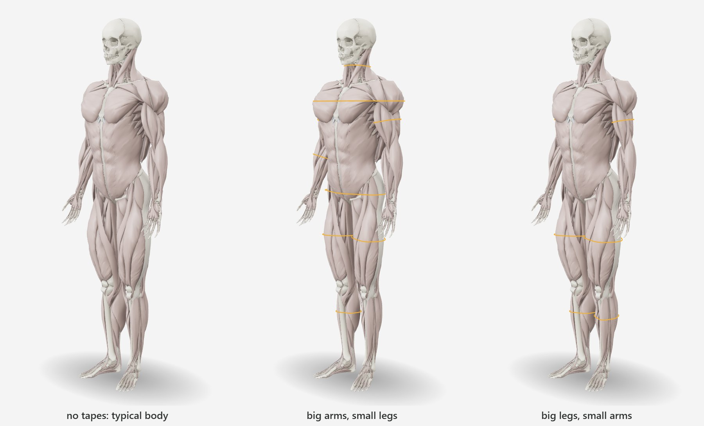

# Fitting the body to tape measures

How the model becomes a person's body from what they record — height, weight, body fat and the
girths of standard tape sites — why each decision was taken, and how it was validated. Code:
`pipeline/fitdata.py` (data in the GLB), `src/anthro.js` (tape → muscle), `src/fit.js` (the fit),
`dev/calibrate.mjs` (ANSUR II calibration), `dev/validate-ansur.mjs` (validation).

- [1. The problem](#1-the-problem)
- [2. Regions](#2-regions)
- [3. From a tape to the model's cross-section](#3-from-a-tape-to-the-models-cross-section)
- [4. Body fat and FFMI](#4-body-fat-and-ffmi)
- [5. The fit](#5-the-fit)
- [6. Calibration on ANSUR II](#6-calibration-on-ansur-ii)
- [7. Validation](#7-validation)
- [8. Limits](#8-limits)

## 1. The problem

The model draws muscle over bone — no skin, no fat. A tape goes around everything. Two pieces of
information must agree:

- the **FFMI** (fat-free mass ÷ height², normalized — [anatomy.md](anatomy.md#5-from-ffmi-to-muscle-volume))
  says how much muscle the person has in total;
- the **girths** say where it is.

If the thigh measures much more than expected for the FFMI, the rest of the body must have less —
the total is the FFMI's. The more sites measured, the more the body stops being "the typical body
of that FFMI" and becomes the person's. The latest value of each site counts.

## 2. Regions

The pipeline's hypertrophy moves each point by the sum of the thickening of all the muscle below
it ([anatomy.md](anatomy.md#6-hypertrophy-in-layers)). That sum splits by region, B = Σ B_r, and
everything after it is linear, so each region is a morph target and equal weights reproduce the
uniform body exactly (checked: the largest difference is 1.5 × 10⁻¹⁵ m, float64 rounding).

**14 regions** (`pipeline/anatomy.py` REGIONS): upper arm, forearm, thigh and lower leg **per
side** (tapes have a side); shoulders, chest, back, neck and upper trapezius, core, hips and
glutes. Weight 0 is the region at the model's minimum FFMI, 1 at its maximum; the allowed range is
[−0.15, 1.35] (beyond it meshes intersect). Layers stay stacked: the deltoid over the triceps gets
the triceps' displacement by position.

The limbs grow **isotropically** in the middle (`morph.isotropize_limbs`): pure stacking grew the
arm almost only in depth (10 × 21 cm at FFMI 26, a tape of 51 cm of muscle alone). A fusiform
muscle grows in area — width and depth. The radial field is computed once and stays linear, so
the morphs remain exactly additive; it matches stacking's added area only to first order, and
changes a limb's own muscle volume by −9 % to +23 % against plain stacking
([validation/anatomy-checks.md](validation/anatomy-checks.md#2-isotropic-limbs-against-plain-stacking)).
In the fit this does not matter for the limbs, which the calibration sets from ANSUR II girths.

## 3. From a tape to the model's cross-section

**Where the model measures.** For every tape site, cross-sections perpendicular to the limb
(shoulder → elbow, hip → knee…) or horizontal on the trunk, at a few levels. The tape is the
**perimeter of the convex hull** of the section — a tape bridges concavities. A minimum enclosing
circle would overestimate oval sections (thigh, arm); the hull is exactly what the tape does. On
limbs the thickest level counts ("at the largest girth"); on the neck the thinnest.

| Site | Where | Regions in the section |
|---|---|---|
| Arm (flexed) | 45–78 % from shoulder to elbow, deltoid excluded | upper arm |
| Forearm | 8–38 % from elbow to wrist | forearm |
| Thigh | 24–56 % from hip to knee (below the gluteal fold to mid-thigh) | thigh, hips |
| Calf | 14–52 % from knee to ankle | lower leg |
| Neck | 25–65 % from C7 to the head, the smallest | neck |
| Shoulders | horizontal, 74.5–80 % of height, arms at the sides | shoulders, chest, back, neck, arms |
| Chest | horizontal, 70–72.5 % of height (nipples at 73.5 % in ANSUR II), arms excluded | chest, back, core |
| Hips / buttocks | horizontal, 45–53 % of height | hips, thighs, core |

Waist and abdomen measure fat and viscera: they only enter the body-fat estimate (§4).

**Material points.** Each section stores the points where mesh edges cross the plane in a
reference shape (a typical FFMI), together with each region's displacement of them: position =
base + Σ_r w_r · disp_r, linear in the weights. The fit recomputes the hull of these points for any
weights, with an analytic gradient: the hull's vertex set is locally constant, so

    d perimeter / d w_r = Σ_edges (p_j − p_i)/|p_j − p_i| · (disp_r,j − disp_r,i)

Only points that reach the hull for some plausible weight combination are kept (uniform weights,
each region at its extremes, 150 random draws), then thinned to one per 4 mm. `check_fit.py`
compares the probes with the true section of the deformed mesh over the plausible range: worst
errors arms ≤ 0.4 %, forearms ≤ 0.2 %, calves ≤ 0.2 %, neck ≤ 1.0 %, chest ≤ 0.8 %, shoulders
≤ 1.6 %, hips ≤ 2.0 %, thighs ≤ 2.9 %.

**Volume.** The signed volume of a closed mesh is Σ a·(b×c)/6 over its triangles; with vertices
affine in the weights it is an **exact cubic polynomial**. The GLB carries one per owning region
(480–505 monomials per model); `check_fit.py` checks it against the mesh to 1e-6.

**Skin and fat** (`anthro.js`). A ring of thickness t around a convex section adds 2πt to its
perimeter (Steiner's formula); with the skinfold S ≈ 2t, the muscle-and-bone perimeter is
C − π·S — the corrected girth of Heymsfield et al. (1982) and Lee et al. (2000). Without
skinfolds, each site's skinfold comes from total body fat — the mean subcutaneous thickness is fat
volume over body surface:

    S(site) = 2.5 mm (skin) + a(site, sex) · (fat mass / body surface area)^0.9

The coefficients of triceps, thigh and calf reproduce the means of Lee et al. (2000, table 2) in
the non-obese and obese groups of both sexes (error ≤ 3 mm); other sites are fractions of those
rings (the biceps carries half the triceps skinfold; at the hips, gluteal fat gives ~2× the thigh
skinfold). The individual skinfold varies ~20 % at the same total fat: it enters the uncertainty
of each measure.

**Height scale.** The model has a fixed height (1.78 m / 1.65 m). A person's girth is carried to
the model's height keeping its relation to the lean mass of the normalized FFMI: the ratio of lean
masses over the ratio of heights is the ratio of cross-section areas; its square root, the ratio
of perimeters. Without an FFMI, geometric similarity (height ÷ height).

## 4. Body fat and FFMI

The FFMI comes from weight, height and body fat. Without a body-fat measure, it comes from the
tapes by the **US Navy method** (Hodgdon & Beckett 1984): men, abdomen at the navel and neck;
women, waist, hips and neck. The uncertainty of the FFMI follows the method: DEXA ±1.5 points of
body fat, hydrostatic ±2, Bod Pod ±2.2, skinfolds ±3–3.5, bioimpedance and Navy ±4, visual ±5 —
carried to the FFMI as Δfat% × weight / height².

## 5. The fit

Unknowns: the 14 weights `w` and the FFMI `F`. Damped Gauss-Newton (Levenberg-Marquardt) with an
active set at the bounds minimises, each residual divided by its uncertainty:

1. **Measures**: hull perimeter at each site vs the tape without skin and fat, at the model's
   height; uncertainty = tape technique (1 %) ⊕ level placement (1.2–4 % by site) ⊕ the site's fat
   estimate. **Huber** loss (k = 2.5), applied as iteratively reweighted least squares.
2. **Typical body**: `w` close to the mean body of that FFMI, μ(F), with the population
   covariance Σ between regions — a big arm pulls forearm and shoulders along, both sides move
   together: ½ (w − μ(F))ᵀ Σ⁻¹ (w − μ(F)).
3. **FFMI**: `F` close to the measured FFMI with the uncertainty of the body-fat method; without a
   body fat, close to the population mean (21.7 ± 2.5 men, 17.7 ± 1.6 women) — the tapes then
   decide how much muscle there is.
4. **Volume**: the model's muscle volume at `w` equals the volume of the typical body of `F`
   (±1 %). **This term takes muscle from one place when another measures more than expected.**

With DEXA body fat, a thigh 15 % above typical grows the thigh and shrinks the rest with the FFMI
nearly fixed; with a visual estimate and every tape larger, the FFMI rises instead. What the
muscle does not explain stays — in proportion to the uncertainties — in the fat of that site: on a
woman a large thigh is largely fat, and the drawn tape still matches the measure.

**Trunk sites as ratios.** Shoulders, chest, hips and neck also measure skeletal breadth and the
shape of fat, which the model does not reproduce person by person — matching them in absolute
value drove the deltoids to the minimum and the glutes to the maximum. They enter as a ratio: the
person's tape over the mean of the population with the same FFMI, applied to the section of the
model's typical body. Limbs enter in absolute value: they are almost all muscle.

**Outliers.** A tape is set aside (status `outlier`) when it lies more than 6 population standard
deviations from what the FFMI and the **other** tapes predict for it (a leave-one-out fit). A real
large thigh is body; a 52 cm calf on a lean body, or 380 typed for 38.0, is an error. A tape
outside its physical range (`TAPE_RANGES`) never enters (`invalid`).

**Uncertainty.** The inverse of the normal matrix at the optimum (Laplace approximation) gives a
standard deviation per region weight; it shrinks as tapes are added.

The solver starts at the typical body of the FFMI, converges in 3–6 iterations and takes about
10 ms (6.5 ms median in Chrome on the benchmark machine; 7–15 ms mean in Node.js across runs).

## 6. Calibration on ANSUR II

The emphasis of the pipeline's hypertrophy was chosen by appearance, not data: at FFMI 26 the
model's arm had 51 cm of muscle alone (a natural bodybuilder at that level has a ~42 cm flexed
tape), and the table FFMI → volume put more muscle than fits real bodies with those tapes.

**ANSUR II** (2012 Anthropometric Survey of U.S. Army Personnel; Gordon et al. 2014; 4 082 men and
1 986 women, 93 measurements, public data) measures exactly these sites: flexed biceps, forearm,
thigh at the gluteal fold, calf, neck, shoulders, chest and buttocks. `dev/calibrate.mjs` computes
for every person the body fat (US Navy, from ANSUR's own neck, waist and hips), the normalized FFMI
(men 21.7, range 15.4–28.3; women 17.7, 14.6–21.1) and every tape in model space as the fit does,
and then:

1. **Expected curve** of each site: cross-section area (girth²) linear in the FFMI, by least
   squares with a second pass without residuals beyond 3.5 σ. On the male model, muscle-only arm
   girth 29 / 33 / 36.5 cm at FFMI 19 / 22 / 25.
2. **Typical body** at every FFMI of the model's range (0.5 steps): the limbs reproduce the curves
   in absolute value, both sides tied; the trunk keeps the model's hypertrophy. The volume of that
   body becomes the volume of the FFMI in the fit (5.6 % less than the pipeline table for men,
   2.3 % for women).
3. **Covariance** of the deviations between sites at the same FFMI, minus the modelled noise (tape,
   estimated fat: at most 80 % of the observed variance), projected to the nearest positive-definite
   matrix, carried to the region weights through the Jacobian (pseudo-inverse), plus a default
   structure for directions no tape sees (back and core inside the chest) and a 2 % side
   asymmetry for the limbs. In the fit this covariance is scaled by `POPULATION_SPREAD`² = 9:
   soldiers train alike; a training app has cyclists, people who skip leg training, bodybuilders.
   The correlations — which carry the information from measured regions to the others — stay
   ANSUR's; only the scale grows.

The calibration is keyed by the **fingerprint** of the model's fit data: after `pipeline/build.py`,
run `node dev/calibrate.mjs <ANSUR II .csv> --write`. `npm test` fails if a model has none.

**What the calibration found.** For women, the modelled noise (tape technique and the estimated
skinfold) accounts for all the observed between-person variance at most sites; the "true"
covariance then sits at its floor (20 % of the observed one) and is poorly determined. Some
correlations saturate after the noise removal (thigh–hips 0.99 for men, 1.0 for women), which ties
those sites in the prior. These are limits of the noise model, not of the data; skinfold
measurements would separate fat from muscle and sharpen them.

## 7. Validation

**Unit tests** (`npm test`, `test/fit.test.mjs`, on the four models): no tapes = typical body;
the body recovered from its own tapes; a thigh 15 % larger takes muscle from the rest keeping the
total; all tapes 10 % larger raise the FFMI with a visual body fat and much less with DEXA; side
asymmetry; typos (370, 5.8, 0, negative) set aside; an inconsistent tape flagged without deforming
the rest; monotonicity; uncertainty falls with more tapes; ten extreme bodies (bodybuilder, obesity,
sarcopenia, legs only, no legs, 2.05 m, 1.48 m, no body fat nor weight, everything huge, everything
tiny) stay in range under 400 ms; the female chest ignored; the Navy formula; Lee's skinfolds; the
precision follows the calibration and the spread; edge cases without height.

**Out of sample** (`dev/validate-ansur.mjs`; full report in
[validation/ansur-holdout.md](validation/ansur-holdout.md)): calibrated on half of ANSUR II,
tested on 600 unseen people of each sex.

| | Men | Women |
|---|---|---|
| fit with every tape | 8.5–14.5 ms mean across runs, 5 iterations | 7–11 ms, 3 iterations |
| \|z\| median / p95 | 0.15 / 0.94 | 0.22 / 0.81 |
| flagged as outliers | 0 % | 0 % |
| fitted − measured FFMI [p5, p95] | [−0.64, +0.74] | [−0.49, +0.57] |
| hidden limb tape, RMS: sex mean → FFMI + body fat → + one tape → + all others | 3.66 → 1.74 → 1.61 → 1.61 cm | 3.28 → 1.64 → 1.57 → 1.51 cm |
| the same, ridge regression on the same inputs | 3.66 → 1.68 → 1.53 → 1.31 cm | 3.28 → 1.53 → 1.43 → 1.30 cm |
| hidden trunk tape (shoulders, chest, hips), RMS with all others: fit / ridge | 3.05 / 4.43 / 2.26 vs 2.87 / 2.65 / 1.95 cm | 2.92 / — / 2.36 vs 2.72 / — / 1.79 cm |

The typical body of an FFMI already halves the error of a population mean, and is within 0.1 cm
of a ridge regression given the same height, weight and body fat. With every other tape the
regression is better — 0.2–0.3 cm on the limbs, up to 1.8 cm on the chest: the fit explains the
tapes with muscle only (one body, regions and their covariance) and treats each site's fat as
independent, while the regression also learns how fat and skeletal breadth co-vary between sites
(a large hip girth predicts a large thigh). Trunk tapes even make some fitted limbs worse (men's
biceps 1.33 cm from the other limb tapes, 1.51 from all). Body fat here comes from the US Navy
formula on the person's own tapes — a proxy, not a reference method; with a girth-free estimate
(BMI and age) the fit is blind to every tape and its limb error with height, weight and body fat
rises to 1.88 cm (men). An ablation of `POPULATION_SPREAD` (1, 2, 3) moves every site by ≤ 0.2 cm
on ANSUR II; 2 is marginally best there, 3 is kept for training populations — a choice not yet
tested on them ([validation/studies.md](validation/studies.md)). ANSUR II measures the limbs on
one side: a synthetic left–right difference is reproduced at 80–85 % (men) and 48–66 % (women);
real asymmetry is untested.

`pipeline/check_fit.py`: region morphs sum to the uniform one; the volume polynomial equals the
mesh; probes vs true sections (§3).

## 8. Limits

- The model has no fat or skin: the drawn tape (`setMeasureRings`) shows the estimated ring.
- A region thickens as a whole: the biceps does not grow apart from the triceps, nor the gluteus
  medius from the maximus. One tape informs its whole region.
- The trunk enters as a ratio over the typical body: two bodies with the same FFMI and shoulders
  5 % above average get the same relative shoulders, whatever their skeleton.
- Calibrated on U.S. Army personnel: adults 17–58, active. Above FFMI 28 (men) and 21 (women) the
  curves are extrapolated.
- Each site's skinfold is estimated from total body fat, not measured; skinfold input would improve
  the fit and the calibration (§6).
- The Navy body fat used in calibration and validation has its own error (±3.5–4 points) and
  reads the neck, waist and hips: the body composition of the evaluation is a proxy.
- With many tapes, a plain regression predicts a hidden tape better (§7): the fit does not model
  how fat and skeletal breadth co-vary between sites. A covariance of the fat residuals, or
  skinfolds, would close part of the gap.
- Both sides of a limb are tied by an assumed 2 % between-side deviation; the fit reproduces most
  of a measured difference for men and about half for women (§7). Real asymmetry, a trained
  population and the population spread are untested — protocols in
  [validation/studies.md](validation/studies.md).

## References

Gordon et al. 2014 (ANSUR II); Heymsfield et al. 1982; Hodgdon & Beckett 1984; Janssen et al. 2000;
Kouri et al. 1995; Lee et al. 2000; Mosteller 1987; Müller et al. 2016 — full entries in
[references.md](references.md).
