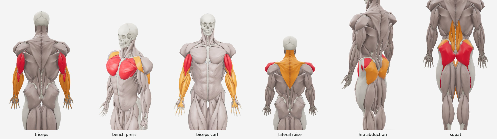
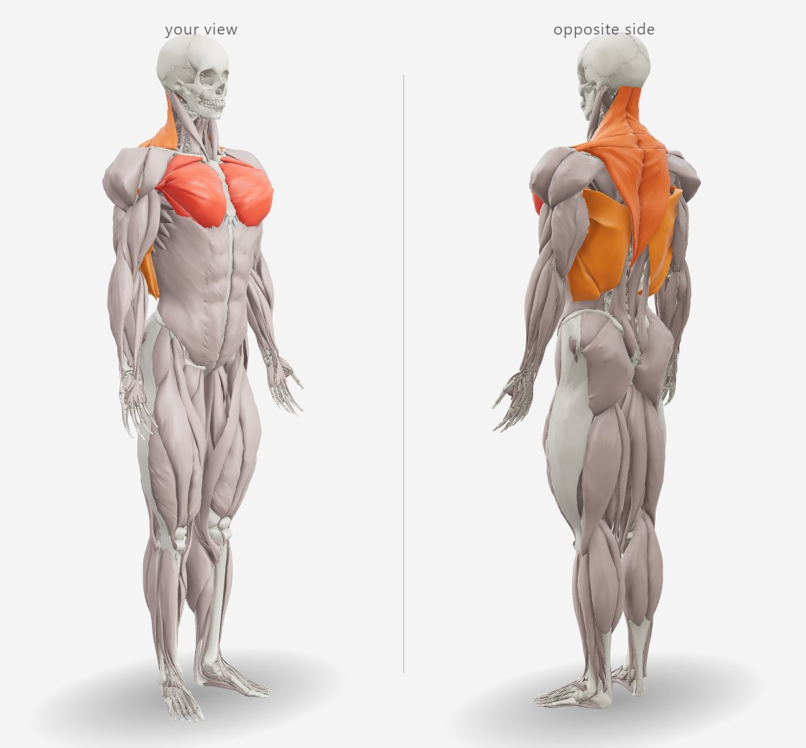

# Views

Where the camera stands: saved views, the automatic default view and the split view. Code:
`src/views.js`, `src/best-view.js`, `src/split-view.js`; the batch tool `dev/evaluate-views.mjs`.

## Saved views

A view is data, relative to the body:

```js
{ yaw: 135, pitch: 10, zoom: 1.4, focus: [0, 0.15, 0] }
```

| Field | Meaning |
|---|---|
| `yaw` | degrees around the body: 0 front, 90 the body's left, 180 back, −90 the body's right |
| `pitch` | degrees above the horizontal, −85 … 85 |
| `zoom` | 1 frames the whole standing body for the current viewport; 2 is twice as close (0.5 … 5) |
| `focus` | look-at point from the centre of the body box, in body heights |

Relative to the body, a view fits both models, any FFMI and any viewport: the camera distance is
the one that frames the body (8 % margin in height, 15 % in width, plus half the body's depth),
divided by `zoom`. `getView()` returns the current one rounded for storage (0.1°, 0.01, 0.001);
`setView()` eases there along the sphere, the shortest way round in azimuth. An application can
store one per exercise, per screen or per user.

The presets are directions: `front` (0, 0.08, 1), `back`, `left`, `right`, the four 3/4 views
with a slightly raised camera, and `top`.

## The automatic view

`view: 'auto'` (or `autoView()`, or `bestView()` to only compute it) chooses where to look from
the activations: a triceps exercise from behind, a chest press at 3/4, a curl from the front.



### Algorithm

1. **Weights.** Each active muscle part gets weight = activation² (a primary at 100 % weighs 1, a
   secondary at 45 % ≈ 0.2: what an exercise is *for* dominates). Parts are grouped by their
   anatomical group.
2. **Candidates.** The body is rendered into the **picking buffer** (part ids, no shading, bones
   included because they occlude muscles) at 90 × 150 px from eight azimuths — front, back, the
   sides and the four 3/4 views — at two heights (pitch 4.6° and 16°): 16 renders.
3. **Visibility per group, normalized.** For each candidate and each active group, the number of
   its pixels, divided by the most that group shows in any candidate. A group counts by how well a
   view shows it *relative to its best view*, not by its size — a large trapezius does not outweigh
   a small lateral deltoid.
4. **Score.** Σ over groups of weight × normalized visibility, × 1.10 for the front and × 1.07 for
   the back (they read most clearly; a tie goes to the front), × 0.94 for the raised camera. The
   best candidate wins.
5. **Framing.** In the winner, the bounding box of the **key muscles** (weight ≥ half the top
   weight) gives a zoom of 1 / max(box width, box height) × 1/1.6 (padding), capped at 1.5×, and a
   focus at the box centre carried to the target plane along the camera axes. When the key muscles
   span more than 62 % of the frame's height (legs and trunk together, most cardio) the whole body
   stays; a zoom below 1.12 is not worth the lost context.

Without activations the view is the front. The result is cached per activation set; computing it
takes ~23 ms on a desktop GPU (15 ms on the lite model) and ~0.6 s with CPU rendering.

### Why this design

- **Rendering, not geometry.** Counting what the camera actually sees accounts for occlusion by
  other muscles and bones, poses and the current body shape. Geometric heuristics (normals facing
  the camera, bounding boxes) count hidden surfaces; a precomputed table per muscle would ignore
  combinations and shapes. The picking pass already exists (taps), so it costs no new shader.
- **Per-group normalization** fixed the first version, which summed raw pixel counts: on a lateral
  raise the large trapezius out-voted the lateral deltoid and the view went to the back.
- **Activation squared** rather than linear: secondary muscles should break ties, not decide.
- **Biases** reflect how people read anatomy: front and back views are the canonical plates of
  anatomy atlases and exercise guides; a raised camera foreshortens the legs.
- **The zoom cap** (1.5×, padding 1.6) keeps the head or the feet in frame often enough for the
  body to stay recognizable; the first version zoomed to 1.8× and cut them.

### Evaluation on an exercise catalog

`dev/evaluate-views.mjs` runs `bestView()` over a JSON catalog of exercises (primaries at 100 %,
secondaries at 45 %), saves a picture of each chosen view for review and can write the views back.
On the 372 exercises of the Trace catalog — strength, functional and cardio — with the models of
version 0.2:

| Chosen azimuth | Exercises |
|---|---:|
| back | 202 |
| front | 138 |
| front 3/4 | 27 |
| back 3/4 | 3 |
| side | 2 |

357 of the 372 views zoom in; 136 use the raised camera. Triceps, hamstrings, calves, glutes,
lats, trapezius and rear deltoids open from behind; chest at 3/4 from the front; biceps, abs,
obliques and quadriceps from the front; hip abduction at 3/4 from behind, where the gluteus medius
shows. The two side views are decline presses (chest, triceps and front deltoid from the side).

The views were reviewed on contact sheets **by the author only**. An agreement study with people
who teach exercise — each rater picks the best of the eight azimuths for 30 exercises — is prepared
(`dev/view-study.mjs`, [validation/studies.md](validation/studies.md#3-the-automatic-view)) but not
yet run.

**Stability.** A view depends on the body it was computed on. The views stored in the Trace catalog
were computed before the ANSUR II recalibration (version 0.1): today 345 of 372 keep the same
azimuth; most of the others flip between the two mirror-image front 3/4 views (−45° ↔ 45°), which
score almost equally on a nearly symmetric body, so a small change of shape decides the tie. Re-run the script
with `--write` after a model change and look at the pictures.

**Limit.** When the key muscles sit on opposite faces of the body — a squat drives the quadriceps
(front) and the glutes (back) equally — any single view hides half of them; the algorithm picks
one side (the back, for the squat). The split view is the answer to that case.

## Split view

The corner button (or `setSplit(true)`) splits the canvas: the left half is the current view, the
right half the **diametrically opposite side** — the camera rotated 180° about the vertical axis
through the target, at the same height and distance. The two move together: turning one half to
one side turns the other to the opposite side, so they always show opposite faces; zoom and pan
are shared. A tap identifies the muscle with the camera of the half it fell in.



Implementation: a second camera and OrbitControls on a transparent pane over each half; a change
on either side moves the other to the opposite position, with a guard against feedback; inertia
is off while split (damped controls would drift apart between frames). The canvas is drawn twice
with scissor rectangles: 3.5 ms instead of 2.3 ms per frame on a desktop GPU.
